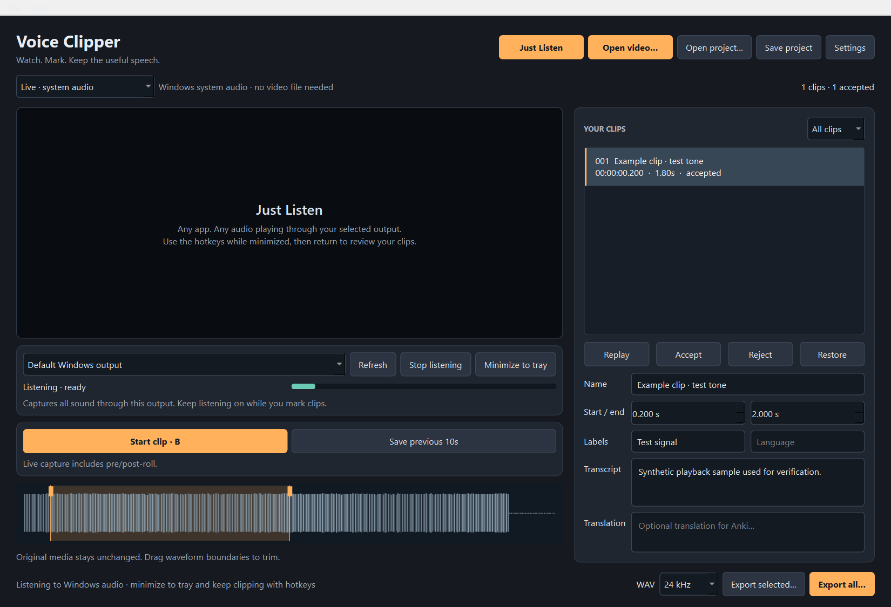

<p align="center">
  
</p>

# Voice Clipper

**Watch → mark → replay → export.** A lightweight VLC-powered player for collecting speech clips, reviewing their boundaries, and exporting audio with transcripts and speaker metadata.

Choose **Just Listen** to collect any audio playing through Windows, or **Open video** to watch and clip a local file. These are the two equally prominent starting actions.



For local videos, Voice Clipper records **media timestamps** and extracts the original audio with FFmpeg. Playback volume and speed do not change the exported audio, and other applications' sounds are excluded. The Windows loopback recorder remains available for browsers and other players.

## Features

- Embedded VLC playback, seeking, speed control, audio-track selection, and fullscreen.
- Start/end marking and **save the previous few seconds** while watching.
- Clip list with replay, adjustable boundaries, speaker/language labels, transcripts, translations, and review status.
- Recoverable rejection: rejected clips remain in the project and are excluded from export.
- Saved JSON projects with stable clip IDs; recordings and source files are preserved.
- Mono PCM16 WAV export with selectable sample rate, CSV/JSONL metadata, and Anki TSV/media export.
- A live loopback mode with a continuous pre-roll/history buffer, device selection, level/status feedback, pending-save discard, and restore.
- Optional Demucs vocal estimates with a source-hash/settings cache, so changing a source does not reuse an old result just because its filename matches.

## Run the GUI

### Windows application folder

If you have a packaged build, extract the **entire** `Voice Clipper` folder and open `Voice Clipper.exe`. Keep `_internal` beside the executable. The bundle includes its Python, VLC, and FFmpeg runtimes; a separate Python installation is unnecessary.

### From source

Use Python **3.11 or newer**. Install [VLC](https://www.videolan.org/vlc/) with the same architecture as Python (normally 64-bit), and make `ffmpeg` and `ffprobe` available on PATH. [FFmpeg downloads](https://ffmpeg.org/download.html) links to platform builds.

```powershell
git clone https://github.com/Khayoon/voice-clipper.git
cd voice-clipper
powershell -NoProfile -ExecutionPolicy Bypass -File scripts/setup-windows.ps1
```

Then double-click **Voice Clipper.cmd**, or run:

```powershell
.\.venv\Scripts\python.exe voice_clipper_gui.py
```

The setup script creates a local `.venv`; it does not change your system Python packages. The launcher does not download or reinstall packages.

On Linux/macOS, install a working libVLC runtime and FFmpeg with your package manager, then create a virtual environment and install `requirements-gui.txt`. Source-file clipping can be used there; system loopback/global hotkeys target Windows.

## Collect and review local-file clips

1. Open or drag a local video/audio file into the player and choose its audio track.
2. Play it. Mark the beginning and end of a useful line, or save the previous configured number of seconds after hearing it.
3. Select a clip to replay it. Adjust its start/end boundaries and add a speaker, language, transcript, or translation.
4. Accept useful clips and reject unwanted takes. Rejection is recoverable; the original media is never edited.
5. Save the project, then export the selected clips or the collection to a new folder.

Marking clips does not copy or decode the whole video. Export jobs run separately from playback. Exported audio uses the selected **source track** at its original timing; slowed-down listening does not produce slowed-down training clips.

Projects store paths to source files rather than embedding their media. Keep the source files accessible when reopening or exporting a project. A project is a clip-selection record, not a media backup.

## Exports

Exported clips have stable ID-based names and retain their original source references and time ranges in metadata. Rejected clips are omitted.

- **WAV:** mono, signed 16-bit PCM at the chosen sample rate. Use the rate required by your trainer, for example 24 kHz or 48 kHz.
- **CSV / JSONL:** filenames, boundaries, review status, speaker/language, transcript/translation, and other stored clip metadata.
- **Anki TSV:** editable text/translation fields and audio references. Import the TSV into an appropriate note type and copy the exported media files into Anki's `collection.media` folder. See [Anki's import documentation](https://docs.ankiweb.net/importing/text-files.html).

Export creates derived files; it does not replace captured originals. Review transcripts and audio before training a model or distributing a lesson. Vocal separation estimates are optional, may retain background sounds, and can introduce artifacts.

## Just Listen: audio from any app

Click **Just Listen**, immediately to the left of **Open video**. It starts the traditional Voice Clipper workflow without requiring any file to be open in the app. Choose the output device your browser, player, or other app uses, and check the level meter and ready status. The recorder captures all sound through that Windows output.

Use **Minimize to tray** to keep listening and clipping in the background. Global hotkeys remain active while listening; double-click the tray icon to return. The permanent hotkey status should say **Global hotkeys active** before switching away. Closing the window finishes capture and closes the application. Returning to source-file mode stops live listening so clip buttons follow the visible mode.

The GUI uses its own checked Windows keyboard listener with an independent message pump. B is passed through to other apps, including text fields; it is not reserved or swallowed. Actions trigger once on release and ignore held-key repeats. The listener stays active when the GUI loses focus, is minimized, or is hidden to the tray. If Windows cannot start it, the hotkey status stays visibly unavailable instead of presenting local app shortcuts as global capture.

Default GUI shortcuts (capture keys can be changed in Settings):

| Shortcut | Action |
| --- | --- |
| B | Mark start/end in VLC; start/stop a live clip in Just Listen |
| Ctrl+Shift+B | Save the previous configured duration (10 seconds by default) |
| F7 | Discard the latest capture/clip, including one still saving |
| Ctrl+Shift+Z | Restore a discarded clip |
| Space / Left / Right | Play-pause / seek back 5 seconds / seek forward 5 seconds |
| F11 / Escape | Fullscreen / leave fullscreen or cancel an unfinished source mark |
| Ctrl+S / Ctrl+Shift+S | Save / Save as |
| Ctrl+O / Ctrl+Shift+O / Ctrl+N | Open media / open project / new project |
| Ctrl+Shift+Q | Quit; also global while Just Listen is active |

Clip shortcuts are suspended while editing text inside Voice Clipper. In other applications, a bare B remains a global capture key while listening; choose a modifier combination in Settings if needed. Hotkey actions trigger on key release in live mode, avoiding repeated toggles when a key is held. GUI settings also include the recordings folder, pre/post-roll, history duration, and maximum live clip length.

You can also run the standalone recorder without the GUI:

```powershell
python -m venv .venv
.\.venv\Scripts\python.exe -m pip install -r requirements.txt
.\.venv\Scripts\python.exe voice_clipper.py --help
.\.venv\Scripts\python.exe voice_clipper.py
```

The CLI prints its configured global shortcuts and output location: B start/stop, F8 save previous seconds, F7 discard, Shift+F7 restore, Ctrl+Shift+Q quit. Settings can be passed as command-line arguments; use `--help` for the full list. It records stereo loopback data and mixes it to mono for WAV output, avoiding SoundCard's single-channel WASAPI issue.

The history buffer continues through active recordings and post-roll, so adjacent clips can retain their pre-roll. Discard targets the newest capture even if its disk write is pending; restore recovers discarded recordings. Clips use immutable IDs instead of reusing numbers. Worker errors clear readiness, and normal shutdown waits for captures/writes to finish.

## Optional vocal separation

```powershell
.\.venv\Scripts\python.exe -m pip install -r requirements-vocals.txt
.\.venv\Scripts\python.exe isolate_vocals.py --help
```

The helper keeps source recordings, writes separate vocal estimates, and checks input hashes plus model/settings before reusing results. Model weights download on first use. For compatible NVIDIA acceleration, install the appropriate CUDA build of PyTorch using the [official selector](https://pytorch.org/get-started/locally/); otherwise Demucs uses the CPU.

## Troubleshooting

- **VLC cannot load:** source installations need matching Python/VLC architectures. Packaged builds need their complete `_internal` folder.
- **FFmpeg is missing:** install both `ffmpeg` and `ffprobe`, or use a complete packaged build. Do not copy only the GUI executable.
- **A file will not seek:** some streams/protocols are not seekable. Local-file export needs an accessible media file; loopback can capture live playback instead.
- **No loopback audio:** choose the correct output device and inspect the level meter. Reconnect/restart capture after changing headphones or speakers.
- **Stream discontinuity warning:** the audio driver reported a possible gap. Review your clips; the session warning is retained in capture metadata. Live-device streaming checks do not establish recording quality.
- **Hotkey conflicts:** configure a different shortcut. Global shortcuts apply while the recorder is active; a bare letter can also affect other applications.
- **A separated clip sounds wrong:** compare it with its preserved original. Demucs does not guarantee isolated dialogue or identify individual speakers.

To check the installed runtimes without opening media or recording audio, run `"Voice Clipper.exe" --diagnostics report.json` from Command Prompt (or `& '.\Voice Clipper.exe' --diagnostics report.json` in PowerShell). The report checks Qt/libVLC, bundled FFmpeg tools, and Windows loopback device discovery.

## Development and Windows builds

```powershell
powershell -NoProfile -ExecutionPolicy Bypass -File scripts/setup-windows.ps1 -Development
.\.venv\Scripts\python.exe -m pytest
powershell -NoProfile -ExecutionPolicy Bypass -File scripts/build-windows.ps1
```

The build script finds installed VLC and `ffmpeg`/`ffprobe`. Override paths with `-VlcPath`, `-FfmpegPath`, `-FfprobePath`, or `-Python`. It creates `dist/Voice Clipper/` with an executable, runtimes, and third-party notices. Distribute the complete folder. Build artifacts are ignored by Git.

The code separates the Qt/VLC interface, project model/export layer, and loopback capture engine. Tests cover state transitions with fake audio, persistence and validation, separation-cache invalidation, and actual FFmpeg output when FFmpeg is available. CI runs Python 3.11/3.13 on Linux and deterministic tests on Windows. Automated tests do not establish real-device audio quality or GPU separation quality.

For a manual Windows device check, run `.venv\Scripts\python.exe scripts/smoke-windows.py`. It briefly opens the real loopback stream and checks that frames arrive, without marking or saving any audio. It does not assess speech quality.

This app collects clips; it does not train models, automatically validate a dataset, or identify speakers. Automatic transcription is not required for capture or export.

## License

Voice Clipper's application source is [MIT licensed](LICENSE). VLC, FFmpeg, Qt, Python packages, and optional model weights have their own licenses; Windows bundles preserve runtime notices. Use recordings with the necessary permissions. The application license grants no rights to third-party audio or voices.
